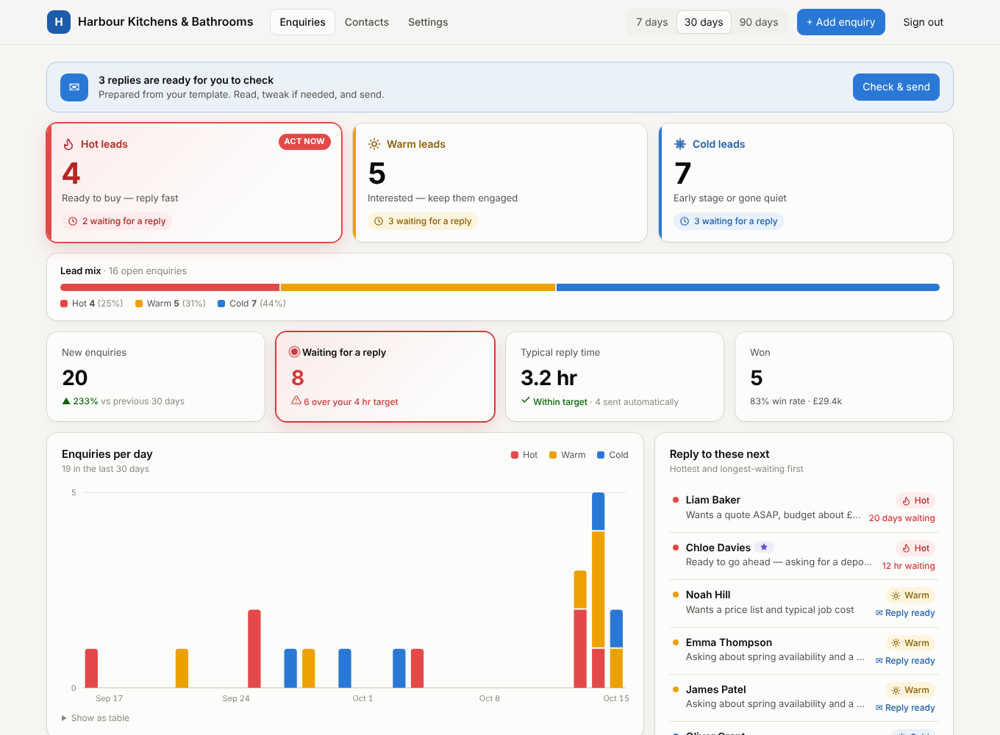
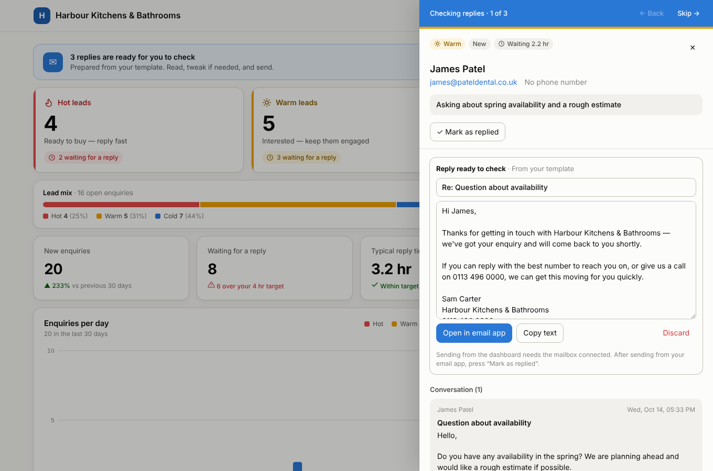
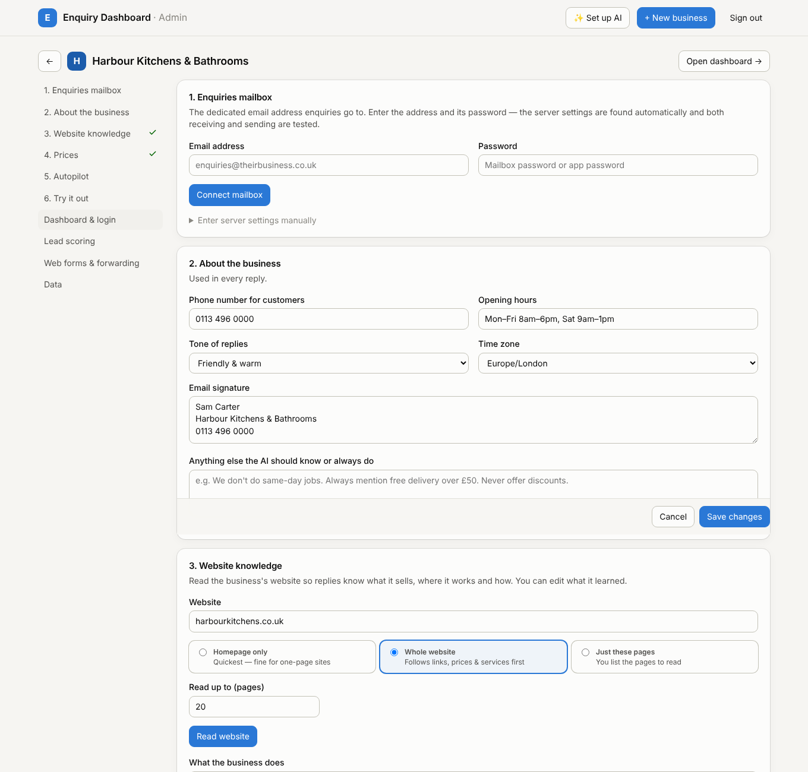
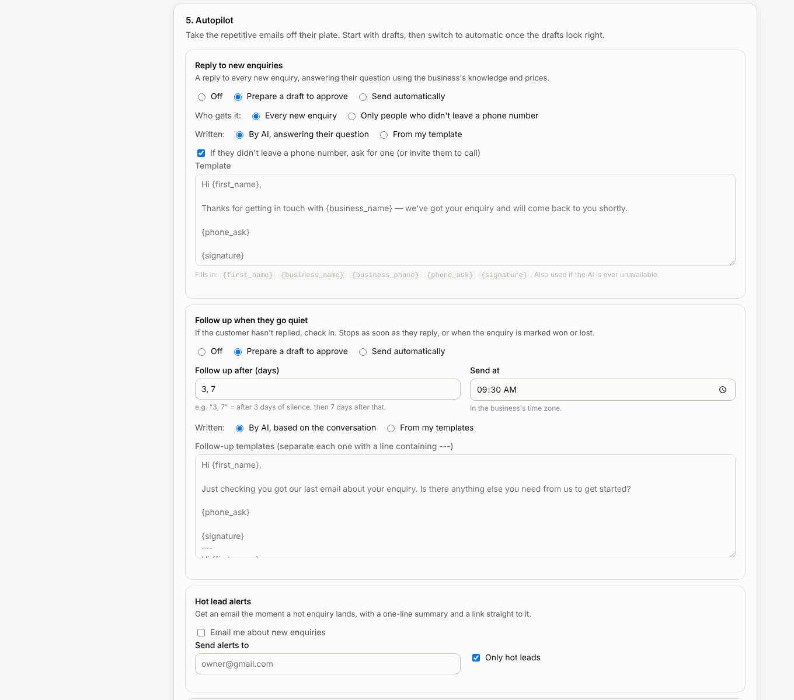

# Email Enquiry Dashboard

An enquiries inbox that does most of the work for a business. Every email sent to the business's dedicated enquiries address is **read, summarised and scored hot, warm or cold**. The business sees at a glance who's ready to buy, and an **autopilot writes the replies**, using what it learned from the business's website and price list. The business checks and sends each reply in one click, or lets the autopilot send them itself. **Follow-ups go out automatically** when a customer goes quiet, so no enquiry gets forgotten.



You set it up once and run it for **as many businesses as you like**. Each business gets its own branded dashboard, login, mailbox, website knowledge, prices and autopilot rules.

## How it works for the business

1. **An enquiry arrives** at their enquiries mailbox (or through their website form).
2. **AI reads it.** It writes a one-line summary ("Wants 500 business cards by Friday"), picks out what they want, when they need it and their budget, files junk and sales pitches away, and judges the lead hot, warm or cold.
3. **A reply is prepared.** It answers the customer's actual question using the business's website knowledge and price list, and asks for a phone number if they didn't leave one. Depending on the settings, the reply waits as a draft to approve or is sent automatically.
4. **The business checks and sends.** A banner shows "3 replies are ready for you to check". Clicking **Check & send** steps through them one by one. Each draft can be edited, sent, or rewritten by AI from a quick instruction ("shorter", "offer Friday delivery").
5. **Follow-ups.** If the customer doesn't reply within (say) 3 days, a follow-up goes out at 9:30 am their time, then another after 7 more days. Follow-ups stop as soon as the customer replies or the enquiry is marked won or lost.
6. **Hot lead alerts.** The owner can get an email the moment a hot enquiry lands.



The dashboard shows:
- hot / warm / cold lead counts
- who is waiting for a reply and who is overdue
- typical reply time, including how many replies were sent automatically
- wins and win rate
- enquiries per day
- a "reply to these next" list
- a board or list of every enquiry

It works on phones and supports dark mode.

## Setting up a business (admin)

Go to `/admin`, click **New business**, and work through the numbered settings:



1. **Enquiries mailbox.** Enter the address and its password. The app finds the server settings itself, then tests both receiving and sending. It recognises Google Workspace, Zoho, GoDaddy, IONOS, Hostinger, Namecheap, 123 Reg, one.com, Fasthosts, Yahoo, iCloud and Fastmail, looks other providers up in Mozilla's public mail-settings database (the one Thunderbird uses), and falls back to common hosting set-ups (`mail.theirdomain.co.uk` and similar). Recent mail is imported quietly; nothing is auto-replied to old emails. Manual settings are there if needed.
2. **About the business.** Phone number, opening hours, signature, tone of voice, time zone, and anything the AI must always (or never) do.
3. **Website knowledge.** Enter their website and choose **Homepage only**, **Whole website** (follows links, reading prices, services, FAQ and about pages first, up to a page limit), or **Just these pages**. AI writes a business profile from what it reads, which you can edit. It also fills in their FAQs.
4. **Prices.** A simple table (product, price, notes) so replies can answer "how much are 500 business cards?" straight away. Prices found on the website are added automatically, or you can paste rows from a spreadsheet. Replies only quote prices from this list or the website and never invent one.
5. **Autopilot.** Choose what happens automatically (screenshot below).
6. **Try it out.** Type a pretend customer email and see the reply the autopilot would send.



The autopilot has these rules:

| Rule | Options |
|---|---|
| **Reply to new enquiries** | Off / prepare a draft to approve / send automatically · everyone, or only people who didn't leave a phone number · written by AI or from your template · ask for their phone number when it's missing · wait N minutes before sending |
| **Follow up when they go quiet** | Off / draft / automatic · after which days (e.g. `3, 7`) · time of day · AI or templates |
| **Hot lead alerts** | Email address · hot leads only, or every enquiry |
| **AI sorting** | Summaries, junk filtering and hot/warm/cold judged by AI |

Some safety rules always apply:
- Replies to a customer's *second* email are always drafts, never sent automatically.
- Nothing is auto-replied to old emails (more than 2 days old, or anything imported on the first sync).
- Follow-ups stop when the customer replies.

## AI

Click **✨ Set up AI** in the admin area and paste an Anthropic API key (from [console.anthropic.com](https://console.anthropic.com/settings/keys)). One key serves every business. It is tested before saving and stored encrypted. The default model is Claude Opus 5.5; Sonnet 5.5 and Haiku 5.5 can be chosen for lower cost. AI is used for:
- reading websites into a business profile (and finding prices and FAQs)
- summarising and sorting each enquiry
- writing replies and follow-ups
- rewriting a draft on request

Without a key everything still works: replies come from your templates, and hot/warm/cold comes from the keyword scoring rules below.

## Lead scoring without AI

Each enquiry starts at 20 points and gains or loses points for buying words (+12 to +30), urgency (+18), mentions of the business's services (+8 to +15), a budget (+15, or −10 if it's under the business's minimum), a phone number (+10), a specific date (+8), a business email address (+5) and follow-up emails (+10 each). Early-stage words cost −15, and a lead loses 10–30 points once it has gone quiet for over a week. By default hot is 60+ and warm is 30–59. You can change these cut-offs and the word lists per business. With AI on, AI judges the temperature, and these signals are still shown.

## Other ways in

- **Website contact form.** Each business has a private inbound address you can use as a form's `action` (an example form is in the settings).
- **Forwarding services** (Postmark, Mailgun, Zapier, Make) can post to the same address.
- **Add enquiry** in the dashboard logs phone or walk-in enquiries.

## Running it

You need Node.js 22.5 or newer.

```bash
npm install
npm run seed      # optional: a demo business with sample enquiries and drafts
npm start
```

Open http://localhost:3000/admin. The admin password is printed in the terminal; set `ADMIN_PASSWORD` to choose your own. The demo dashboard is at `/b/harbour-kitchens-bathrooms` with access code `demo-1234`.

| Setting | What it does |
|---|---|
| `ADMIN_PASSWORD` | Admin password (generated on first run if not set) |
| `APP_URL` | Public address, used for links in alert emails (otherwise taken from the admin page you use) |
| `ANTHROPIC_API_KEY` | Optional. An alternative to entering the key in the admin area |
| `APP_SECRET` | Optional. Secret for logins and encryption (otherwise generated into `data/secret.key`) |
| `DATA_DIR` | Where the database and keys live (default `./data`) |

### Deploying

**On your own server (e.g. a 123-reg dedicated server):** follow [deploy/DEPLOY-123REG.md](deploy/DEPLOY-123REG.md). It covers the subdomain DNS record, Node.js, a systemd service, nginx with free HTTPS, updates and backups.

It runs as one Node process with a SQLite file, so any small server or container host works. Serverless hosts like Vercel don't fit, because the app needs a persistent disk and runs background inbox checks and follow-ups. With Docker:

```bash
docker build -t enquiries .
docker run -p 3000:3000 -v enquiries-data:/data -e ADMIN_PASSWORD=... -e APP_URL=https://enquiries.example.com enquiries
```

Keep `/data` on persistent storage and back it up. It holds the database and the key that encrypts stored mailbox passwords and the AI key. Serve it over HTTPS.

### Notes on mailboxes

- **Gmail / Google Workspace** need an *app password* (Google account → Security → 2-Step Verification → App passwords). The connect screen explains this if a normal password is rejected.
- **Microsoft 365 / Outlook.com** have switched off password sign-in for email apps on most accounts. Forward that mailbox to another mailbox and connect that one, or use the inbound address with a forwarding service.

## Project layout

```
src/server.js       web server, API and login
src/automations.js  autopilot: replies, follow-ups, alerts, approval queue, scheduler
src/ai.js           Claude: business profile, enquiry reading, reply drafting
src/knowledge.js    website reader (homepage / crawl / chosen pages)
src/autoconfig.js   finds IMAP/SMTP settings from an email address
src/mailer.js       sends email from the business's mailbox
src/inbox.js        IMAP sync of the enquiries and Sent folders
src/enquiries.js    storing enquiries, threading, dashboard numbers
src/scoring.js      keyword hot / warm / cold scoring
src/settings.js     default settings for each business
public/             dashboard, admin and login pages (plain HTML/CSS/JS, no build step)
test/               tests (npm test)
```
